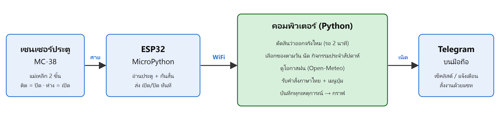
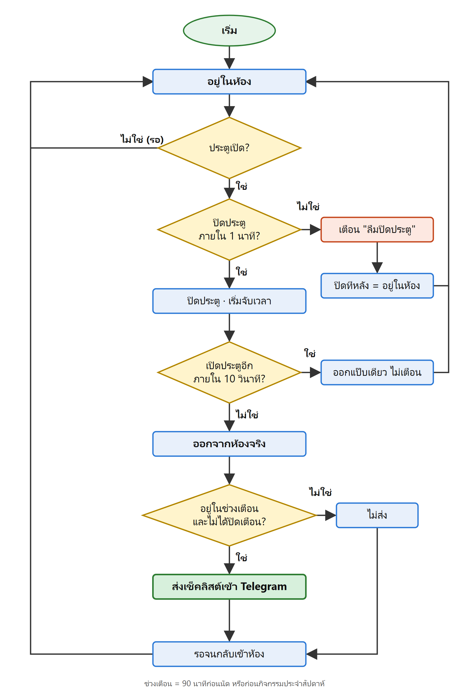

# Door Buddy · ผู้ช่วยหน้าห้อง

ระบบเตือนลืมของเมื่อออกจากห้อง ติดเซนเซอร์แม่เหล็กที่ประตู พอระบบรู้ว่าเราออกจากห้องจริง จะส่งเช็คลิสต์ของที่ต้องพกเข้า Telegram ตามบริบทของวันนั้น (นัด กิจกรรมประจำสัปดาห์ โอกาสฝน) และไม่เตือนตอนออกไปแป๊บเดียว

Mini project วิชา Computer Software Lab · เขียนด้วย Python ทั้งหมด (คอม = Python · บอร์ด ESP32 = MicroPython)



## ทำอะไรได้บ้าง
- **รู้เองว่าออกจากห้อง:** ปิดประตูแล้วรอ 10 วินาที ถ้าไม่เปิดกลับ = ออกจริง · เปิดกลับเร็ว = แค่เปิดประตู ไม่เตือน
- **เช็คลิสต์ตามบริบท:** ของพกทุกวัน · ของเฉพาะวัน · ของสำหรับนัด · ของสำหรับกิจกรรมประจำสัปดาห์ · ร่มเมื่อโอกาสฝน ≥ 50% (Open-Meteo)
- **เตือนเฉพาะช่วงที่ควรเตือน:** 90 นาทีก่อนนัด/กิจกรรมประจำสัปดาห์ · กลับห้องก่อนเวลานัดแล้วออกอีก = เตือนอีก
- **เช็คลิสต์ล่วงหน้า:** 60 นาทีก่อนนัด ส่งรายการให้เตรียมของก่อนออก
- **นัด กับ ประจำสัปดาห์แยกกัน:** นัด = ครั้งเดียว (หาหมอ เตะบอล) · ประจำสัปดาห์ = ซ้ำทุกสัปดาห์ (เรียนทุกจันทร์) งดบางสัปดาห์ได้
- **สั่งงานผ่าน Telegram:** เมนูปุ่ม + พิมพ์ภาษาไทยได้ เช่น `ลืมร่ม`, `พรุ่งนี้ไม่ต้องเตือน`, `เมนู`
- **แจ้งเตือนอื่น ๆ:** ประตูเปิดค้างเกิน 1 นาที · บอร์ดขาดการเชื่อมต่อ
- **บันทึก + วิเคราะห์:** ทุกเหตุการณ์ลง `data/events.csv` · `analyze.py` สรุปเป็นกราฟ

## ตัดสินยังไงว่า "ออกจริง"



## อุปกรณ์
| อุปกรณ์ | หน้าที่ |
|---|---|
| ESP32 DevKit V1 (MicroPython) | อ่านเซนเซอร์ประตู ส่ง "เปิด/ปิด" ให้คอมทาง WiFi (UDP พอร์ต 4210) |
| เซนเซอร์แม่เหล็ก MC-38 | สายหนึ่งต่อ GND อีกสายต่อ D32 (ปิด = 0, เปิด = 1) |
| คอมพิวเตอร์ (Python) | ตัดสินว่าออกจริงไหม เลือกของ คุยกับ Telegram |
| Telegram บนมือถือ | รับเช็คลิสต์ สั่งงานด้วยแชท |

คอมกับบอร์ดต้องต่อ **WiFi วงเดียวกัน** (ESP32 ใช้ได้แค่ 2.4GHz · WiFi บางที่บล็อกอุปกรณ์คุยกันเอง ใช้ hotspot มือถือแทนได้)

## ติดตั้งฝั่งคอม
1. ติดตั้ง Python 3 แล้ว (ไม่บังคับ) ติดตั้งไลบรารีวาดกราฟ:
   ```
   python -m pip install -r requirements.txt
   ```
2. สร้างบอท Telegram กับ [@BotFather](https://t.me/BotFather) แล้วคัดลอก `secrets.example.json` เป็น `secrets.json` ใส่ `TELEGRAM_TOKEN`
3. ทักบอทในมือถือ 1 ข้อความ แล้วหา chat id:
   ```
   python -m pc.telegram
   ```
   ใส่ค่าที่ได้ใน `TELEGRAM_CHAT_ID` ของ `secrets.json` (ไฟล์นี้อยู่ใน `.gitignore` ห้ามขึ้น git)
4. แก้ `LAT` / `LON` ใน `config.json` เป็นพิกัดที่พัก (ใช้ดูโอกาสฝน)

## รันฝั่งคอม
```
python -m pc.main          # ใช้งานจริง
python -m pc.main --demo   # โหมดเดโม: เตือนได้ทุกเวลา เตือนทุกครั้งที่ออก บันทึกแยกลง data/demo/
```
ไม่มีบอร์ดก็ลองได้ กดคีย์บอร์ดในหน้าต่างโปรแกรมจำลองประตู: `o` = เปิด · `c` = ปิด · `l` = ดูเช็คลิสต์ · `s` = สถานะ · `w` = จำลองฝน · `q` = ออก

ครั้งแรกโปรแกรมจะสร้าง `rules.json` / `activities.json` จากไฟล์ `*.example.json` ให้เอง (ข้อมูลส่วนตัว ไม่ขึ้น git)

## ติดตั้งบอร์ด ESP32
1. แฟลช MicroPython (ESP32_GENERIC) จาก [micropython.org](https://micropython.org/download/ESP32_GENERIC/):
   ```
   python -m pip install esptool mpremote mpy-cross
   python -m esptool --port COM3 erase_flash
   python -m esptool --port COM3 --baud 460800 write_flash 0x1000 ESP32_GENERIC-xxxx.bin
   ```
2. ใส่ `WIFI_SSID` / `WIFI_PASS` ใน `secrets.json` แล้วอัปโหลดขึ้นบอร์ด:
   ```
   python -m mpremote connect COM3 cp secrets.json :secrets.json
   python tools/upload_board.py COM3
   ```
3. กดปุ่ม EN บนบอร์ด · ไฟสีฟ้าติด = ต่อ WiFi แล้ว · หน้าจอโปรแกรมฝั่งคอมขึ้น `บอร์ดประตูเชื่อมแล้ว`

## ทดสอบ
```
python -m unittest           # เทสต์อัตโนมัติ (เวลาจำลองทั้งหมด ไม่ต้องรอจริง)
python tools/scenarios.py    # จำลองสถานการณ์เข้าออกห้องในเวลาจริง แล้วเทียบผลที่ควรได้
python analyze.py --sample   # สร้างข้อมูลจำลอง 14 วันแล้ววาดกราฟ (--demo = ข้อมูลโหมดเดโม)
```

## โครงโฟลเดอร์
```
core/        ตรรกะหลัก ไม่มี I/O (เทสต์ได้ทั้งหมด)
  guard.py      state machine ตัดสินว่าออกจริงไหม / เตือนเมื่อไร
  checklist.py  เลือกของตามบริบท
  weekly.py     กิจกรรมประจำสัปดาห์
  commands.py   แยกคำสั่งภาษาไทยจากแชท
pc/          โปรแกรมฝั่งคอม
  main.py       ลูปหลัก + จัดการข้อมูล
  bot.py        เมนูปุ่มใน Telegram + ถามทีละขั้น
  telegram.py   ส่ง/รับ Telegram (thread แยก)
  door_link.py  รับสถานะประตูจากบอร์ด (UDP)
  weather.py    โอกาสฝนจาก Open-Meteo
esp32/       โปรแกรมบนบอร์ด (door_sensor.py = ตัวที่ใช้จริง)
tools/       อัปโหลดบอร์ด + ตัวจำลองสถานการณ์
tests/       unittest
analyze.py   สรุปข้อมูลจาก events.csv เป็นรายงาน + กราฟ
```

## ค่าที่ปรับได้ (`config.json`)
| ค่า | ความหมาย | ค่าเริ่ม |
|---|---|---|
| `OUT_DELAY` | ปิดประตูแล้วรอกี่วินาทีถึงนับว่าออกจริง | 10 |
| `OPEN_ALERT_SEC` | ประตูเปิดค้างกี่วินาทีถึงเตือน | 60 |
| `BEFORE_CLASS_MIN` | ช่วงเตือนก่อนนัด (นาที) | 90 |
| `PREP_MIN` | ส่งเช็คลิสต์ล่วงหน้ากี่นาทีก่อนนัด (0 = ปิด) | 60 |
| `RAIN_PROB` | โอกาสฝนกี่ % ถึงเพิ่มร่ม | 50 |
| `NO_CLASS_WINDOW` | ช่วงเตือนของวันที่ไม่มีนัด | 08:00–11:00 |

## ข้อจำกัด
- ใช้เซนเซอร์ตัวเดียว ไม่รู้ว่าเปิดประตูจากด้านไหน: เปิดรับของแล้วปิดจากในห้อง (ไม่ถึง 1 นาที) ระบบอาจคิดว่าออกไปแล้ว → กดปุ่ม "ยังไม่ได้ออก" ใต้ข้อความเตือน
- คอมต้องเปิดโปรแกรมไว้ และต้องอยู่ WiFi เดียวกับบอร์ด
- เคยลองให้บอร์ดคุย Telegram เองทั้งหมด แต่ ESP32 รุ่นนี้ไม่มี PSRAM ใช้ MicroPython แล้วหน่วยความจำไม่พอสำหรับ HTTPS (ช้าและหลุดบ่อย) จึงแบ่งงาน: บอร์ดอ่านประตู คอมคุย Telegram · โค้ดรุ่นทดลองเก็บไว้ใน `esp32/app.py`, `esp32/net.py`
